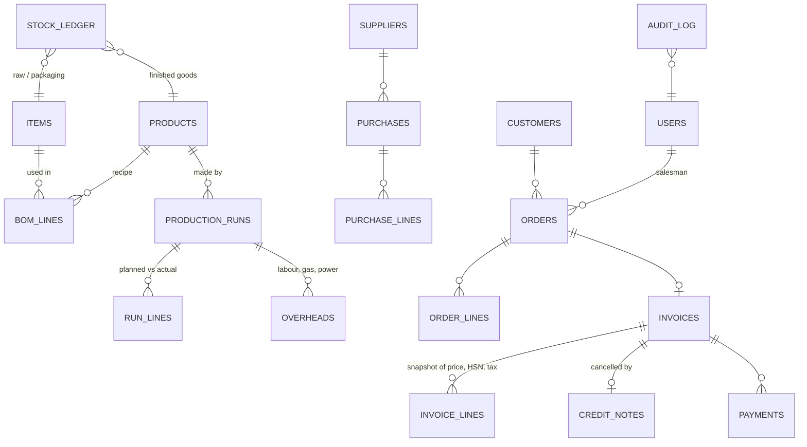

# Design note

## 1. Data model

`stock_ledger` is the heart. Each row is one movement: item **or** product (a CHECK constraint forces exactly one), signed quantity, signed value, and its source (`doc_type`, `doc_id`, `doc_ref`). Sources: `opening`, `purchase`, `production_issue`, `production_output`, `overhead`, `sales_dispatch`, `credit_note`, `adjustment`.

Invoices copy customer name, GSTIN, address, rate, HSN and tax into the invoice rows, so later master-data edits never change a posted document.

## 2. How stock and BOM consumption are computed

* **No stored balances.** Balance = `SUM(qty_milli)` over the ledger. The stock summary shows opening + receipts + issues + adjustments = closing, and a test asserts it for every item.
* **Units.** Items have a base unit (kg, litre, piece). Quantities are stored as integer thousandths of it. Entry in g, ml, kg, L or pcs is converted on the way in (`core.to_milli`); incompatible units are rejected. Finished goods are packets; order lines can be entered in cartons (`packets_per_carton`).
* **Recipe.** `bom_lines` holds the quantity of each raw and packaging item per batch; `products.bom_yield_milli` holds packets per batch.
* **Run.** Starting a run for *n* batches writes `run_lines` with `planned = bom x n` and posts the raw-material issues (what the floor actually issued, defaulting to plan). Closing the run posts packaging issues (pouches default to good + damaged + scrapped; cartons to good packets / packets per carton, rounded up) and one finished-goods receipt for the good packets. Issues that exceed stock are refused.
* **Variance.** For each line and for yield: `(actual - planned) / planned`, flagged when `|actual - planned| x 10000 > tolerance_bp x planned` (integer test, default 300 bp = 3%).
* **Sales.** An order is verified against finished goods; invoicing is refused when stock is short (or reduced to stock on the admin's confirmation, logged). Dispatch posts the finished-goods issue at weighted-average cost and records COGS on each invoice line. A credit note returns dispatched goods at the same cost.

## 3. Costing and valuation

* **Valuation: weighted average**, kept per item as `SUM(value) / SUM(qty)` over the ledger. Purchases add their taxable amount; an issue takes `value x qty / balance` (the whole remaining value when it empties the stock, so no paise drift is left behind).
* **Run cost** = materials and packaging issued at that average + overheads charged to the run. **Cost per packet** = run cost / good packets. Finished goods enter stock at run cost, so stock value, COGS and margin tie to the same numbers. Overheads added after the run post a zero-quantity value movement to finished goods.
* **Overhead allocation.** Direct (labour, gas, power) entered against a run is charged to it. Overheads entered for a month without a run are shared across that month's runs in proportion to good packets (Cost per packet report).
* **Why weighted average:** the factory mixes flour in one bin, so attributing a specific purchase lot to a specific batch would be false precision; it also keeps stock value stable when prices move, and is simple to explain to an auditor.

## 4. Tax

Place of supply is the customer's state. Same state as the factory (Tamil Nadu, 33): CGST and SGST at half the rate each. Otherwise IGST at the full rate. Tax is computed per invoice line in paise and rounded half-up. Invoices are numbered per financial year (`INV/2026-27/0001`, credit notes `CN/...`).

## 5. Audit and control

Every create, edit, approval, dispatch, payment and cancellation writes `audit_log` (user, time, entity, detail including before/after for edits). Invoices are never deleted: cancelling issues a credit note, returns stock, and leaves both documents on the register. Roles are enforced by the API; the UI only hides what the API would refuse.
